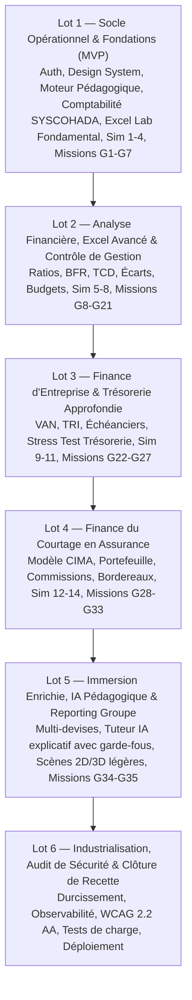

# 03 — Backlog Produit et Exigences Fonctionnelles Détaillées

**Version :** 1.0.0 — Date : 17 Octobre 2026  
**Cadre de gestion :** Méthodologie Agile / Scrum avec priorisation MoSCoW et livraison par lots verticaux.

---

## 1. Structure du Backlog

Le backlog est structuré en **Epics stratégiques**, décomposées en **User Stories (US)** prêtes pour le développement (DoR - Definition of Ready), accompagnées de critères d'acceptation stricts (Gherkin syntax quand pertinent) et de leur priorisation :
- **Must Have (M)** : Indispensable au fonctionnement du lot.
- **Should Have (S)** : Forte valeur ajoutée pédagogique ou métier.
- **Could Have (C)** : Enrichissement ergonomique ou approfondissement.
- **Won't Have now (W)** : Reporté aux versions post-recette.

---

## 2. Découpage par Lots de Réalisation

---

## 3. Backlog Détaillé par Epic et User Stories

### Epic 1 : Socle Technique, Authentification et Profil Utilisateur

#### US-101 : Authentification locale sécurisée et gestion des profils
- **En tant qu'** apprenant, formateur ou administrateur,  
  **je veux** créer un compte, me connecter de façon sécurisée et gérer mes préférences (langue, devise XOF par défaut, objectif de carrière),  
  **afin d'** accéder à mes parcours d'apprentissage personnalisés et conserver mon historique.
- **Priorité :** Must Have (Lot 1) — **Points :** 5
- **Critères d'acceptation :**
  1. Hachage sécurisé des mots de passe (Argon2 ou bcrypt avec salage).
  2. Gestion des rôles applicatifs étanches (Apprenant, Formateur, Administrateur).
  3. Session sécurisée (JWT ou cookie HttpOnly avec politique SameSite).
  4. Possibilité d'initialiser ou de basculer vers un profil de démonstration pré-configuré (étudiant, comptable junior, analyste).

#### US-102 : Diagnostic initial adaptatif et génération du plan d'apprentissage
- **En tant qu'** apprenant nouvellement inscrit,  
  **je veux** passer un questionnaire de diagnostic rapide (10 à 15 questions pratiques) ciblant mes connaissances en comptabilité, Excel et finance,  
  **afin d'** obtenir une recommandation de parcours adaptée à mon niveau réel et à ma disponibilité hebdomadaire.
- **Priorité :** Must Have (Lot 1) — **Points :** 8
- **Critères d'acceptation :**
  1. Évaluation par domaine distinct et non par simple note globale.
  2. Proposition d'un plan hebdomadaire ajustable (ex. parcours standard 24 semaines, parcours accéléré 8 semaines).
  3. Sauvegarde des résultats du diagnostic dans le profil utilisateur pour mesurer le delta de progression final.

---

### Epic 2 : Moteur Pédagogique, Parcours et Évaluation

#### US-201 : Lecteur de cours et activités interactives
- **En tant qu'** apprenant,  
  **je veux** naviguer dans un parcours structuré (cours -> exemple résolu -> exercice -> simulateur -> mission),  
  **afin de** progresser de façon rythmée avec un apprentissage actif.
- **Priorité :** Must Have (Lot 1) — **Points :** 8
- **Critères d'acceptation :**
  1. Affichage clair des objectifs pédagogiques et du temps estimé.
  2. Présence obligatoire de l'exemple résolu étape par étape avant l'exercice autonome.
  3. Glossaire contextuel cliquable pour chaque terme financier clé.
  4. Sauvegarde automatique de l'état d'avancement (leçon terminée, exercice réussi).

#### US-202 : Moteur de feedback et correction explicative
- **En tant qu'** apprenant soumettant une réponse à un exercice,  
  **je veux** recevoir un retour instantané qui décompose la nature exacte de mon erreur (signe inversé, compte incorrect, mauvaise plage de cellules),  
  **afin de** comprendre la cause de l'erreur sans me voir asséner un statut "Faux" frustrant.
- **Priorité :** Must Have (Lot 1) — **Points :** 5
- **Critères d'acceptation :**
  1. Tolérance numérique configurable pour les calculs avec arrondis (+/- 0.01 ou 1 FCFA).
  2. Fourniture d'un indice progressif (indice 1 : orientation méthodologique, indice 2 : formule applicable) avant la solution complète.
  3. Enregistrement de l'erreur dans la matrice des lacunes pour alimenter la révision espacée.

---

### Epic 3 : Simulateurs Comptables et Financiers Déterministes

#### US-301 : Simulateur de l'équation comptable et partie double SYSCOHADA
- **En tant qu'** apprenant en comptabilité,  
  **je veux** saisir des écritures comptables dans un journal interactif et observer en temps réel la mise à jour du grand livre et de la balance,  
  **afin d'** ancrer le principe de la partie double et de l'équilibre bilanciel.
- **Priorité :** Must Have (Lot 1) — **Points :** 13
- **Critères d'acceptation :**
  1. Contrôle bloquant de l'équilibre Débit = Crédit avant validation de l'écriture.
  2. Nomenclature conforme au plan comptable SYSCOHADA Révisé (comptes à 4 chiffres).
  3. Visualisation simultanée des comptes en T et de la balance à 6 colonnes.
  4. Calcul automatique du résultat d'exploitation et du résultat net à chaque écriture.

#### US-302 : Simulateur d'états financiers et de clôture périodique
- **En tant qu'** apprenant,  
  **je veux** préparer les écritures d'inventaire (amortissements, charges à payer) et générer automatiquement le bilan et le compte de résultat,  
  **afin de** maîtriser le cycle de clôture comptable complet.
- **Priorité :** Must Have (Lot 1) — **Points :** 8
- **Critères d'acceptation :**
  1. Calcul automatique des dotations d'amortissement selon la méthode retenue (linéaire, prorata temporis).
  2. Report rigoureux du résultat net au passif du bilan dans les capitaux propres.
  3. Égalité parfaite Actif = Passif garantie mathématiquement.

#### US-303 : Simulateur d'analyse financière et tableau de bord de ratios
- **En tant qu'** analyste financier junior,  
  **je veux** charger les états financiers d'une entreprise et calculer instantanément ses ratios de liquidité, solvabilité, rentabilité et son BFR,  
  **afin d'** établir un diagnostic argumenté face aux seuils sectoriels.
- **Priorité :** Must Have (Lot 2) — **Points :** 8
- **Critères d'acceptation :**
  1. Formules déterministes exposées avec numérateur et dénominateur détaillés.
  2. Alertes visuelles non bloquantes en cas de franchissement de seuils d'alerte (ex. ratio de liquidité réduite < 0.8).
  3. Décomposition du BFR en jours de chiffre d'affaires (DSO, DPO, DIO).

#### US-304 : Simulateur de seuil de rentabilité et budget flexible
- **En tant que** contrôleur de gestion junior,  
  **je veux** simuler différentes hypothèses de prix unitaire, coût variable et coûts fixes,  
  **afin de** visualiser le seuil de rentabilité en FCFA et en volume, ainsi que la date exacte du point mort.
- **Priorité :** Must Have (Lot 2) — **Points :** 8
- **Critères d'acceptation :**
  1. Graphique dynamique interactif traçant la droite du chiffre d'affaires et la droite des coûts totaux.
  2. Calcul automatique du levier opérationnel et de la marge de sécurité.
  3. Recalcul instantané lors du déplacement des curseurs (slider UI).

#### US-305 : Simulateur de décision d'investissement (VAN, TRI, Payback)
- **En tant que** directeur financier ou chargé de projet d'investissement,  
  **je veux** saisir une série de flux nets de trésorerie sur plusieurs années et un taux d'actualisation,  
  **afin de** comparer les projets à l'aide de leur VAN, TRI et durée de récupération actualisée.
- **Priorité :** Must Have (Lot 3) — **Points :** 8
- **Critères d'acceptation :**
  1. Algorithme de recherche du TRI par méthode numérique de Newton-Raphson avec convergence garantie.
  2. Tracé de la courbe de profil de la VAN en fonction du taux d'actualisation (taux 0% à 30%).
  3. Explication des divergences de classement possibles entre VAN et TRI (effet d'échelle).

---

### Epic 4 : Laboratoire Excel Intégré

#### US-401 : Moteur tableur web interactif avec évaluation de formules
- **En tant qu'** apprenant,  
  **je veux** manipuler une grille de cellules, saisir des formules financières et voir les résultats s'actualiser immédiatement,  
  **afin d'** acquérir les réflexes professionnels sans quitter mon navigateur.
- **Priorité :** Must Have (Lot 1) — **Points :** 13
- **Critères d'acceptation :**
  1. Support complet des fonctions fondamentales : `SOMME`, `MOYENNE`, `MIN`, `MAX`, `SI`, `ET`, `OU`, `SIERREUR`.
  2. Gestion des références relatives (`A1`), absolues (`$A$1`) et mixtes (`$A1`, `A$1`).
  3. Messages d'erreurs standard restitués fidèlement (`#DIV/0!`, `#VALEUR!`, `#REF!`, `#N/A`).
  4. Formats monétaires XOF, pourcentages et séparateurs de milliers.

#### US-402 : Fonctions avancées de recherche et tableaux croisés (TCD)
- **En tant qu'** apprenant de niveau intermédiaire à expert,  
  **je veux** utiliser `RECHERCHEX`, `INDEX/EQUIV`, `SOMME.SI.ENS` et construire des synthèses de type Tableau Croisé Dynamique,  
  **afin de** traiter des jeux de données d'entreprise complexes.
- **Priorité :** Must Have (Lot 2) — **Points :** 13
- **Critères d'acceptation :**
  1. Support complet de `RECHERCHEX` avec gestion de la valeur de repli si absent.
  2. Module d'agrégation multidimensionnelle avec sélection de lignes, colonnes et métriques calculées.
  3. Possibilité d'importer et d'exporter des données aux formats CSV et XLSX.

#### US-403 : Module d'audit et de détection des erreurs de classeur
- **En tant qu'** auditeur ou analyste financier,  
  **je veux** analyser un classeur pré-rempli pour identifier automatiquement les formules contenant des valeurs fixes en dur (hardcoding) et les ruptures de cohérence,  
  **afin de** fiabiliser les reportings financiers.
- **Priorité :** Should Have (Lot 2) — **Points :** 8
- **Critères d'acceptation :**
  1. Mise en surbrillance des cellules violant les règles de modélisation (constante numérique au sein d'une formule).
  2. Calcul d'un score de conformité du classeur sur 100 points.

---

### Epic 5 : Jeux Vidéo Sérieux et Scénarios Immersifs

#### US-501 : Moteur de quêtes et missions métier gamifiées
- **En tant qu'** apprenant,  
  **je veux** être plongé dans des missions scénarisées (contexte narratif, rôle professionnel, contraintes de temps, objectifs chiffrés),  
  **afin d'** appliquer mes compétences dans des conditions réalistes d'entreprise.
- **Priorité :** Must Have (Lot 1 pour missions G1-G7, incréments Lots 2 à 5) — **Points :** 13
- **Critères d'acceptation :**
  1. Écran de briefing initial immersif avec dialogues interactifs des parties prenantes (manager, client, DG).
  2. Espaces de travail interconnectés (bureau virtuel, classeur de données, journal comptable, documents justificatifs).
  3. Conséquences réelles calculées suite à chaque décision (ex. impact sur la trésorerie ou la satisfaction client).
  4. Écran de débriefing final avec note détaillée, analyse des erreurs commises et corrigé professionnel.

#### US-502 : Missions d'investigation financière et escape game comptable
- **En tant qu'** apprenant joueur,  
  **je veux** investiguer des anomalies dissimulées dans les pièces justificatives ou les états financiers d'une PME d'Abidjan,  
  **afin de** développer un esprit critique d'audit financier.
- **Priorité :** Should Have (Lot 2) — **Points :** 8
- **Critères d'acceptation :**
  1. Possibilité d'inspecter des factures fictives, relevés bancaires et contrats clients dans l'interface.
  2. Détection de fraudes ou d'erreurs courantes (doublons de facturation, fausses écritures de régularisation).

---

### Epic 6 : Spécialisation Courtage en Assurance (Cadre CIMA / International)

#### US-601 : Simulateur de portefeuille de contrats et gestion des renouvellements
- **En tant que** collaborateur d'un cabinet de courtage d'assurance,  
  **je veux** gérer un portefeuille de contrats (Santé, Flotte Auto, IARD, Risques Industriels), suivre les échéances et prioriser les renouvellements,  
  **afin de** maximiser le taux de rétention client et sécuriser le chiffre d'affaires du cabinet.
- **Priorité :** Must Have (Lot 4) — **Points :** 13
- **Critères d'acceptation :**
  1. Base de données fictive complète avec clients entreprises, branches, dates d'échéances et primes.
  2. Calcul automatique du taux de rétention en nombre et en volume de primes.
  3. Scénarios de simulation d'attrition avec impact sur les commissions futures du cabinet.

#### US-602 : Calculateur de commissions et rapprochement des bordereaux assureurs
- **En tant que** responsable administratif et financier de courtier,  
  **je veux** recalculer les commissions contractuelles attendues et les rapprocher des bordereaux transmis par les compagnies d'assurances partenaires,  
  **afin d'** identifier immédiatement les sous-commissions et erreurs de taux.
- **Priorité :** Must Have (Lot 4) — **Points :** 8
- **Critères d'acceptation :**
  1. Gestion des conventions de commissions paramétrables par compagnie et par branche.
  2. Lettrage et pointage automatique identifiant les écarts en FCFA.
  3. Édition d'un état des réclamations prêt pour envoi aux compagnies d'assurance.

---

### Epic 7 : Intelligence Artificielle Pédagogique & Garde-Fous

#### US-701 : Tuteur conversationnel interactif avec garde-fous déterministes
- **En tant qu'** apprenant bloqué sur une notion ou un calcul,  
  **je veux** solliciter un tuteur intelligent qui m'explique le raisonnement et me fournit des indices sans me donner immédiatement la réponse brute,  
  **afin de** progresser par moi-même tout en étant accompagné.
- **Priorité :** Should Have (Lot 5) — **Points :** 8
- **Critères d'acceptation :**
  1. L'assistant s'appuie obligatoirement sur les cours et les règles de calcul déterministes du système.
  2. Interdiction formelle d'inventer des taux d'imposition ou des textes juridiques : obligation de citer la source officielle.
  3. Possibilité pour l'apprenant ou l'administrateur de désactiver l'IA à tout moment.

---

## 4. Synthèse d'Estimation Globale

- **Lot 1 (MVP Fondations & Socle Métier) :** 55 Story Points (Priorité absolue)
- **Lot 2 (Analyse, Excel Avancé & Contrôle) :** 45 Story Points
- **Lot 3 (Finance d'Entreprise & Investissement) :** 32 Story Points
- **Lot 4 (Finance du Courtage en Assurance) :** 39 Story Points
- **Lot 5 (Immersion, IA & Consolidation) :** 26 Story Points
- **Lot 6 (Industrialisation & Recette) :** 20 Story Points
- **Total Backlog Produit :** 217 Story Points
