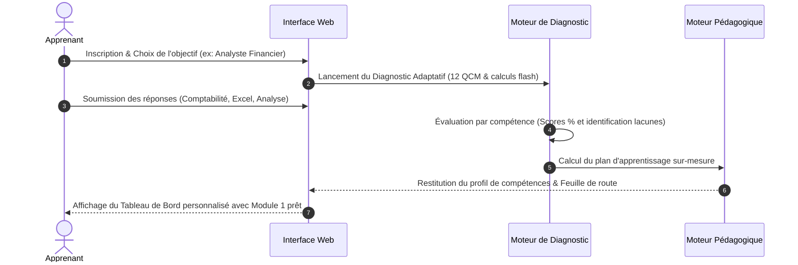

# 04 — Personas, Parcours Utilisateurs et Ingénierie Pédagogique

**Version :** 1.0.0 — Date : 17 Octobre 2026  
**Équipe responsable :** Équipe F (Expertise Métier & Pédagogique) & Équipe C (UX/UI Design)

---

## 1. Fiches Personas Approfondies

### Persona 1 : Koffi — L'Étudiant en Reconversion (Débutant)
- **Profil :** 24 ans, diplômé d'une licence générale à l'Université Félix Houphouët-Boigny d'Abidjan, souhaite intégrer la direction financière d'une entreprise ivoirienne.
- **Niveau initial :** Connaissances financières théoriques floues, appréhension face au jargon comptable et aux tableaux Excel complexes.
- **Objectifs :**
  - Comprendre concrètement ce que signifient "Actif", "Passif", "Débit" et "Crédit".
  - Être capable d'enregistrer des opérations courantes et d'établir une balance sans erreur.
  - Maîtriser les formules Excel essentielles pour être opérationnel dès son premier stage ou emploi.
- **Obstacles majeurs :** Peur de faire des erreurs de calcul, manque de mise en situation concrète sur des pièces réelles.
- **Attentes vis-à-vis de la plateforme :** Des explications simples et progressives, des missions scénarisées stimulantes (type jeu vidéo), des encouragements et des retours bienveillants lors d'erreurs.

---

### Persona 2 : Aminata — La Comptable Junior en Montée en Compétences
- **Profil :** 28 ans, comptable depuis 3 ans dans une société de services à Abidjan-Plateau.
- **Niveau initial :** Solide en saisie comptable et déclarations fiscales courantes, mais limitée dès qu'il s'agit d'interpréter les bilans ou d'anticiper la trésorerie.
- **Objectifs :**
  - Évoluer vers un poste d'Analyste Financier ou de Responsable Administratif et Financier (RAF).
  - Maîtriser le calcul et l'interprétation des ratios financiers, du BFR et du tableau de flux.
  - Savoir rédiger une note d'analyse financière convaincante pour le Conseil d'Administration.
- **Obstacles majeurs :** Manque de recul stratégique sur les chiffres, difficulté à traduire les constats comptables en recommandations d'affaires.
- **Attentes vis-à-vis de la plateforme :** Des simulateurs financiers avancés, des cas pratiques d'entreprises ivoiriennes réalistes et des simulations d'entretiens de direction générale.

---

### Persona 3 : Jean-Luc — Le Contrôleur de Gestion & Modélisateur Excel
- **Profil :** 32 ans, contrôleur de gestion junior au sein d'un groupe industriel sous-régional.
- **Niveau initial :** Bonnes bases en comptabilité analytique et budgets, utilisateur fréquent d'Excel mais confronté à des classeurs lents, fragiles et non sécurisés.
- **Objectifs :**
  - Maîtriser la modélisation financière avancée, les Tableaux Croisés Dynamiques et les formules matricielles (`RECHERCHEX`, `SOMME.SI.ENS`).
  - Automatiser le calcul des écarts (effets prix, volume, mix) et la chaîne budgétaire.
  - Auditer et assainir des classeurs corrompus avant transmission aux directeurs opérationnels.
- **Obstacles majeurs :** Perte de temps sur des tâches manuelles de nettoyage de données, risque d'erreurs de modélisation non détectées.
- **Attentes vis-à-vis de la plateforme :** Un laboratoire Excel exigeant avec audit de formules, des cas de négociation budgétaire sous tension et des jeux d'enquête financière.

---

### Persona 4 : Fatou — La Gestionnaire de Portefeuille Courtage en Assurance
- **Profil :** 30 ans, chargée de comptes chez un courtier d'assurance international opérant en Afrique de l'Ouest (zone CIMA).
- **Niveau initial :** Très à l'aise dans la relation commerciale avec les entreprises clientes, mais souhaitant approfondir la rentabilité technique et financière des polices.
- **Objectifs :**
  - Comprendre en détail le modèle économique du courtier : flux de primes de tiers, commissions contractuelles, taxes d'assurance, impayés.
  - Rapprocher sans faille les primes encaissées avec les bordereaux émis par les compagnies d'assurances partenaires.
  - Optimiser les campagnes de renouvellement pour réduire l'attrition du portefeuille et dégager une marge contributive saine.
- **Obstacles majeurs :** Dispersion des données entre assureurs multiples, bordereaux parfois erronés ou incomplets.
- **Attentes vis-à-vis de la plateforme :** Des simulateurs de commissions et de rentabilité de portefeuille dédiés, des jeux de rôle simulant la négociation des accords assureurs et la fidélisation des comptes à risque.

---

### Persona 5 : Dr. Touré — Le Formateur & Responsable Académique
- **Profil :** 45 ans, enseignant-chercheur et consultant formateur en finance d'entreprise.
- **Niveau initial :** Expert métier et méthodologique.
- **Objectifs :**
  - Suivre en temps réel la progression d'une cohorte de 40 apprenants.
  - Identifier instantanément les notions sources de blocages collectifs.
  - Consulter les travaux soumis et annoter les notes d'analyse financière des étudiants.
- **Attentes vis-à-vis de la plateforme :** Un tableau de bord formateur clair, la possibilité d'assigner des missions de remédiation et d'exporter les statistiques de réussite.

---

## 2. Parcours Utilisateur & Expérience d'Apprentissage

### 2.1 Cycle d'Onboarding et Diagnostic Initial

### 2.2 La Boucle d'Apprentissage Pédagogique en 8 Étapes

Pour chaque sous-compétence, l'apprenant traverse un cycle cognitif complet :
1. **Découvrir :** Lecture synthétique de la notion, définitions clés et schéma conceptuel interactif.
2. **Observer :** Analyse d'un cas résolu pas à pas avec décryptage des calculs et astuces de praticien.
3. **Pratiquer :** Exercice court avec saisie de chiffres ou de formules et correction instantanée.
4. **Manipuler :** Utilisation du simulateur autonome pour tester les limites et observer les variations.
5. **Jouer :** Immersion dans une mission métier scénarisée (bureau virtuel, dialogue, documents à vérifier).
6. **Analyser :** Débriefing explicatif comparant les décisions prises à la meilleure pratique de place.
7. **Consolider :** Algorithme de révision espacée réinjectant les points fragiles à $J+3$ et $J+7$.
8. **Valider :** Examen ou livrable final attestant de la maîtrise opérationnelle dans le portfolio.

---

## 3. Programmes et Plans de Formation Types

### 3.1 Plan Standard de Montée en Compétences (24 Semaines)

| Période | Bloc Thématique | Objectifs Clés & Livrables |
| :--- | :--- | :--- |
| **Semaines 1 à 4** | **Comptabilité Générale SYSCOHADA** | Maîtrise de la partie double, saisie du journal, grand livre, balance, amortissements et clôture des comptes. |
| **Semaines 5 à 8** | **Laboratoire Excel Essentiel à Opérationnel** | Maîtrise des références absolues, formules conditionnelles, `RECHERCHEX`, nettoyage de données et TCD. |
| **Semaines 9 à 12** | **Analyse Financière & Diagnostic** | Analyse horizontale/verticale, ratios de liquidité/solvabilité/rentabilité, BFR et rédaction de note financière. |
| **Semaines 13 à 16** | **Contrôle de Gestion & Budgets** | Coûts complets/variables, calcul du seuil de rentabilité, élaboration budgétaire et décomposition des écarts. |
| **Semaines 17 à 19** | **Finance d'Entreprise & Trésorerie** | Valeur temps de l'argent, échéanciers d'emprunt, critères d'investissement (VAN, TRI), plan de trésorerie glissant. |
| **Semaines 20 à 22** | **Finance Appliquée au Courtage en Assurance** | Modèle de courtage CIMA, calcul et rapprochement des commissions, gestion du portefeuille et renouvellement. |
| **Semaines 23 à 24** | **Grand Projet de Synthèse & Portfolio** | Simulation intégrée complète d'un cabinet de courtage ou d'une PME d'Abidjan, soutenance simulée et portfolio. |

### 3.2 Plan Accéléré "Reconversion Express" (8 Semaines)
Dédié aux profils ayant déjà des bases quantitatives et disponibles à temps plein (15 à 20 heures/semaine) :
- **S1-S2 :** Comptabilité SYSCOHADA & états financiers.
- **S3-S4 :** Excel financier & tableaux croisés dynamiques.
- **S5-S6 :** Analyse financière, BFR et gestion de trésorerie.
- **S7-S8 :** Courtage en assurance, contrôle budgétaire et grand cas de synthèse.

---

## 4. Algorithme de Répétition Espacée et Réactivation Cognitive

Le système intègre un modèle inspiré de l'algorithme SuperMemo-2 adapté aux compétences quantitatives :
- À chaque tentative d'exercice ou de simulateur, un facteur de rétention $R$ est mis à jour :
  $$R_{n} = R_{n-1} \times EF$$
  où $EF$ est le facteur d'aisance déterminé par le nombre de tentatives et l'exactitude au premier essai.
- Les notions ayant donné lieu à une erreur critique (ex. inversion débit/crédit, oubli de la TVA dans le calcul de trésorerie, hardcoding d'une constante dans Excel) sont reprogrammées sous forme de **défis flash de 3 minutes** intégrés au début de chaque session suivante.
- L'apprenant visualise sa **Carte Cognitive de Compétences** avec 3 statuts colorimétriques clairs :
  - *Vert émeraude* : Compétence maîtrisée et consolidée.
  - *Ambre* : Compétence en cours d'acquisition ou nécessitant une réactivation.
  - *Gris ardoise* : Compétence non encore abordée.
