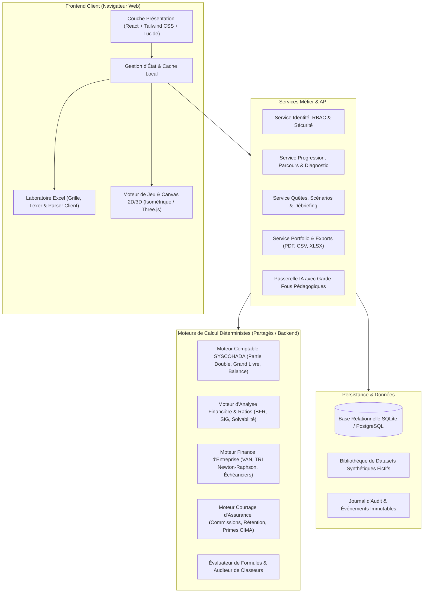
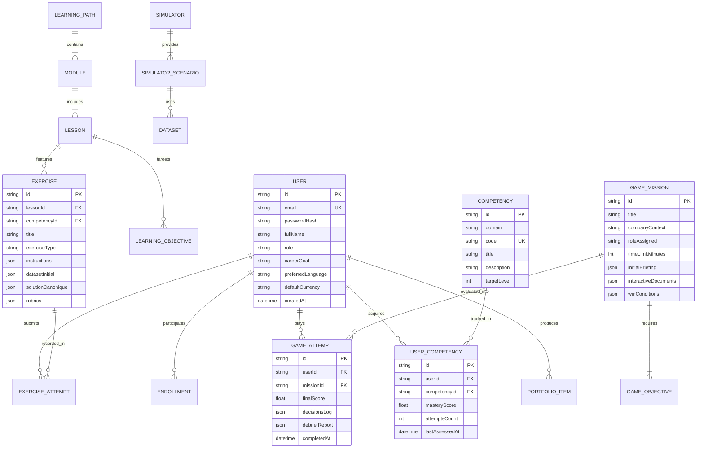

# 05 — Architecture Technique Cible et Spécifications des Composants

**Version :** 1.0.0 — Date : 17 Octobre 2026  
**Équipe responsable :** Équipe B (Architecture et Infrastructure) & Équipe E (Backend et Données)

---

## 1. Principes Directeurs d'Architecture

Conformément aux exigences des cahiers des charges et aux arbitrages de la direction technique :
1. **Monolithe Modulaire Hautement Découplé :**  
   Priorité absolue à un monolithe modulaire moderne en TypeScript/Node.js plutôt qu'à une poussière de microservices prématurés. Les frontières de domaines métier (Comptabilité, Finance, Excel, Jeux, Évaluation) sont strictement isolées par des interfaces typées.
2. **Déterminisme Arithmétique Absolu :**  
   Les bibliothèques de calcul financier sont pures, sans effet de bord, et testables unitairement en isolation totale. Le format monétaire utilise des entiers (centimes de FCFA) ou une bibliothèque décimale dédiée (`decimal.js` ou équivalent entier) pour éliminer les dérives de virgule flottante binaire IEEE 754.
3. **Moteur Hybride Client/Serveur :**  
   - Côté client : Réactivité instantanée (< 50 ms) pour la frappe de formules Excel, la manipulation de curseurs de sensibilité et les animations 2D/3D.
   - Côté serveur : Contrôle d'intégrité, validation officielle des examens, exécution des corrigés certifiés et persistance des résultats.
4. **Graduation Visuelle et Éco-Conception :**  
   Les composants 2D (Canvas interactif, diagrammes SVG) sont la norme par défaut ultra-légère. Les modules 3D (Three.js) sont isolés dans des bundles chargés à la demande (*lazy-loading*) pour garantir un chargement < 2 secondes sur réseaux mobiles 3G/4G.

---

## 2. Vue d'Ensemble de l'Architecture Logique



---

## 3. Décomposition des Modules Métier

### 3.1 Moteur Comptable SYSCOHADA (`src/core/accounting`)
- **Structure d'une écriture :**
  ```typescript
  export interface JournalEntryLine {
    accountNumber: string; // Ex: "411100" (Clients locaux)
    accountLabel: string;
    debit: number;        // Montant en FCFA (entier)
    credit: number;       // Montant en FCFA (entier)
    refPiece?: string;
  }

  export interface JournalEntry {
    id: string;
    date: string;
    label: string;
    lines: JournalEntryLine[];
    isBalanced: boolean;   // sum(debit) === sum(credit)
  }
  ```
- **Règles métier :**
  - Rejet de toute écriture dont le solde $\sum \text{Débit} - \sum \text{Crédit} \neq 0$.
  - Génération automatique du Grand Livre (agrégation par compte) et de la Balance à 6 colonnes (Soldes d'ouverture Débit/Crédit, Mouvements Débit/Crédit, Soldes de clôture Débit/Crédit).
  - Génération des états financiers conformes au Système Normal SYSCOHADA : Bilan (Actif / Passif), Compte de Résultat en liste avec Soldes Intermédiaires de Gestion (Marge commerciale, Valeur ajoutée, EBE, Résultat d'exploitation, Résultat financier, Résultat des activités ordinaires, Résultat net).

### 3.2 Moteur d'Évaluation Excel (`src/core/excel`)
- **Pipeline de traitement :**
  1. *Tokenisation (Lexer)* : Reconnaissance des identifiants (`A1`, `$B$3`), noms de fonctions (`SOMME`, `RECHERCHEX`), opérateurs arithmétiques (`+`, `-`, `*`, `/`) et chaînes de caractères.
  2. *Analyse syntaxique (Parser AST)* : Construction de l'arbre syntaxique abstrait pour détecter les parenthèses manquantes ou imbrications invalides.
  3. *Évaluation (Evaluator)* : Résolution des dépendances avec détection des références circulaires.
  4. *Audit Pédagogique* : Comparaison entre la formule soumise par l'étudiant et la formule canonique, détection des constantes écrites en dur (*hardcoding*) et des formules alternatives correctes.

### 3.3 Moteur de Calcul Financier & Investissement (`src/core/finance`)
- **Formules déterministes certifiées :**
  - **Valeur Actuelle Nette (VAN) :**
    $$\text{VAN} = \sum_{t=1}^{n} \frac{\text{CF}_t}{(1 + k)^t} - I_0$$
  - **Taux de Rentabilité Interne (TRI) :** Résolution par la méthode de Newton-Raphson de l'équation $f(r) = 0$ avec tolérance $\epsilon = 10^{-6}$ et maximum 100 itérations.
  - **Amortissement d'Emprunt (Annuité Constante) :**
    $$A = C_0 \times \frac{i}{1 - (1 + i)^{-n}}$$
  - **Seuil de Rentabilité (Break-even) :**
    $$\text{SR} = \frac{\text{Charges Fixes Totales}}{\text{Taux de Marge sur Coût Variable}}$$

### 3.4 Moteur de Courtage en Assurance CIMA (`src/core/insurance`)
- **Règles de calcul et de flux :**
  - Prime Totale TTC = Prime Nette (HT) + Frais Accessoires + Taxes d'Assurance (14.5% en CI sur dommages).
  - Commission Brute Courtier = Prime Nette $\times$ Taux Conventionnel de Branche.
  - Commission Nette = Commission Brute - Rétrocessions éventuelles.
  - Taux de Rétention du Portefeuille :
    $$\text{Taux Rétention} = \frac{\text{Primes Renouvelées}}{\text{Primes Échues à Renouveler}} \times 100$$
  - Contrôle de conformité CIMA Art. 13 : Alerte de non-couverture si la prime n'est pas encaissée dans les délais légaux.

---

## 4. Modèle Conceptuel de Données (MCD / ERD)



---

## 5. Spécification des Contrats d'API (REST / OpenAPI)

Toutes les requêtes et réponses JSON respectent la norme stricte :
- Format des montants monétaires : nombres entiers (en FCFA).
- Encodage des dates : norme ISO 8601 (`YYYY-MM-DDTHH:mm:ssZ`).
- En-tête de corrélation pour l'audit : `X-Request-ID`.

### Endpoints Principaux :

1. **Authentification & Profil :**
   - `POST /api/auth/register` : Création de compte.
   - `POST /api/auth/login` : Authentification et émission du jeton.
   - `GET /api/user/profile` : Consultation du profil et préférences.
   - `GET /api/user/competencies` : Matrice de maîtrise par compétence.

2. **Parcours Pédagogique & Exercices :**
   - `GET /api/paths` : Catalogue des parcours et modules.
   - `GET /api/lessons/:id` : Contenu complet de la leçon (cours, exemple, quiz).
   - `POST /api/exercises/:id/verify` : Soumission de la solution pour correction déterministe immédiate.

3. **Simulateurs Métier :**
   - `POST /api/simulators/accounting/calculate` : Validation et recalcul journal -> balance.
   - `POST /api/simulators/financial-analysis/ratios` : Calcul de la batterie de ratios.
   - `POST /api/simulators/controlling/breakeven` : Recalcul du seuil de rentabilité.
   - `POST /api/simulators/corporate-finance/investment` : Calcul VAN, TRI et échéancier.
   - `POST /api/simulators/insurance/commissions` : Calcul et rapprochement de bordereaux.

4. **Jeux Vidéo Sérieux & Missions :**
   - `GET /api/games/missions/:id` : Chargement du briefing, rôle, données et documents.
   - `POST /api/games/missions/:id/action` : Soumission d'une décision et réception de l'impact en direct.
   - `POST /api/games/missions/:id/finish` : Évaluation finale, débriefing et mise à jour du portfolio.

---

## 6. Sécurité Applicative, Sauvegardes et Performance

1. **Contrôle d'Accès basé sur les Rôles (RBAC) :**
   - Contrôle systématique des autorisations côté serveur. Les routes formateurs et administrateurs vérifient le rôle dans le token signé.
2. **Protection contre les Vulnérabilités Web Majeures :**
   - Protection CSRF et en-têtes de sécurité HTTP (Content Security Policy, X-Frame-Options, HSTS).
   - Validation stricte des schémas d'entrée avec Zod pour neutraliser les injections de charge utile.
3. **Stratégie de Sauvegarde & Résilience :**
   - Sauvegarde transactionnelle quotidienne de la base de données.
   - Sauvegarde automatique de l'état de travail en cours dans le stockage local du navigateur (`localStorage`/`IndexedDB`) avec synchronisation périodique sur le serveur toutes les 60 secondes.
4. **Stratégie de Performance (Objectifs Non Négociables) :**
   - Temps de réponse de l'API de calcul déterministe : $< 150 \text{ ms}$.
   - Rendu de la grille Excel : 60 images par seconde lors du défilement.
   - Poids initial du bundle JavaScript : $< 250 \text{ Ko}$ compressé (Gzip/Brotli).
