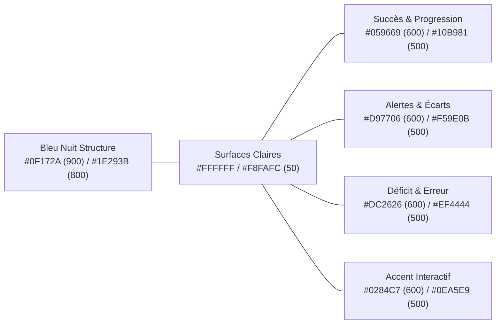

# 06 — Design System et Spécifications Ergonomiques (UI/UX)

**Version :** 1.0.0 — Date : 17 Octobre 2026  
**Équipe responsable :** Équipe C (Design UI/UX et Identité Visuelle)

---

## 1. Direction Artistique & Identité de Marque

L'identité visuelle de **FINLEARN IMMERSION** fusionne quatre univers exigeants :
1. **L'élégance d'une institution financière de premier plan :** sobriété, rigueur, typographie millimétrée, alignements parfaits.
2. **L'ergonomie d'un logiciel professionnel moderne (SaaS Fintech) :** densité d'information maîtrisée, lisibilité des tableaux, rapidité d'exécution.
3. **L'efficacité pédagogique active :** feedback coloré instantané, repères visuels clairs de progression, clarté des décompositions de formules.
4. **L'immersion narrative d'un jeu vidéo d'entreprise :** tableau de bord de mission (HUD), dossiers interactifs, dialogues de parties prenantes et transitions soignées.

---

## 2. Palette Chromatique et Sémantique des Couleurs

### 2.1 Valeurs Hexadécimales et Rôles Précis

- **Couleurs de Structure & Textes :**
  - `slate-950` (`#020617`) : Textes titres de haute emphase, arrières-plans sombres des en-têtes de mission.
  - `slate-900` (`#0F172A`) : Navigation principale, barres latérales d'outils, typographies principales.
  - `slate-800` (`#1E293B`) : En-têtes de tableaux financiers, cartes actives.
  - `slate-600` (`#475569`) : Textes secondaires, légendes, libellés de métadonnées.
  - `slate-300` (`#CBD5E1`) : Bordures de cartes, séparateurs de cellules de tableur.
  - `slate-100` (`#F1F5F9`) : Arrière-plans de conteneurs de formulaire, lignes alternées de tableaux.
  - `slate-50` (`#F8FAFC`) : Arrière-plan global de l'application en mode clair.
  - `white` (`#FFFFFF`) : Fond des cartes de contenu, fond des cellules de saisie active.

- **Couleurs Sémantiques Métier :**
  - **Progression / Équilibre / Bénéfice (Vert Émeraude) :**
    - `emerald-600` (`#059669`) / `emerald-500` (`#10B981`) : Taux de rentabilité positif, équilibre comptable atteint, validation d'exercice, badges débloqués.
    - `emerald-50` (`#ECFDF5`) : Fond d'alerte de succès, surbrillance d'une cellule calculée conforme.
  - **Vigilance / Hypothèses / Alerte Neutre (Ambre & Cuivre) :**
    - `amber-600` (`#D97706`) / `amber-500` (`#F59E0B`) : Seuil critique approché (trésorerie basse, ratio sous surveillance), indice pédagogique disponible.
    - `amber-50` (`#FFFBEB`) : Fond des bandeaux d'avertissement.
  - **Déficit / Rupture d'Équilibre / Erreur Critique (Crimson) :**
    - `red-600` (`#DC2626`) / `red-500` (`#EF4444`) : Écriture comptable déséquilibrée, perte d'exploitation, formule en erreur (`#DIV/0!`), sanction dans une mission.
    - `red-50` (`#FEF2F2`) : Cellules en erreur, écarts défavorables.
  - **Action & Sélection (Bleu Cyan Professionnel) :**
    - `sky-600` (`#0284C7`) / `sky-500` (`#0EA5E9`) : Boutons d'actions primaires, focus clavier, liens interactifs, cellules Excel sélectionnées.

---

## 3. Typographie et Hiérarchie Visuelle

Deux familles typographiques complémentaires sont déployées :
1. **Interface & Textes Courants :** `Inter`, alternative `system-ui` sans-serif pour une lisibilité maximale sur tous écrans.
2. **Nombres, Formules & Comptes Comptables :** `JetBrains Mono` ou `Fira Code` (chiffres à chasse fixe / *tabular figures* `tnum`), garantissant l'alignement vertical parfait des montants monétaires dans les balances et états financiers.

### Échelle Typographique :
- **Titre H1 (Page / Mission) :** `text-3xl font-bold tracking-tight text-slate-900` (30px / line-height 36px)
- **Titre H2 (Section / Simulateur) :** `text-2xl font-semibold tracking-tight text-slate-800` (24px / line-height 32px)
- **Titre H3 (Sous-section / Carte) :** `text-lg font-semibold text-slate-800` (18px / line-height 28px)
- **Texte Courant (Corps) :** `text-base font-normal text-slate-700` (16px / line-height 24px)
- **Texte Secondaire / Aide :** `text-sm font-medium text-slate-500` (14px / line-height 20px)
- **Valeurs Chiffrées & Formules :** `font-mono text-sm font-medium tracking-tight tabular-nums` (14px)

---

## 4. Catalogue des Composants UI Fondamentaux

### 4.1 Boutons (`Button`)
- **Primary :** Fond `sky-600`, texte blanc, survol `sky-700`, ombre douce `shadow-sm`, arrondi `rounded-lg`, état focus visible `focus:ring-2 focus:ring-sky-500 focus:ring-offset-2`.
- **Secondary :** Fond blanc, bordure `slate-300`, texte `slate-700`, survol `slate-50`.
- **Success / Valider :** Fond `emerald-600`, texte blanc, survol `emerald-700`.
- **Danger :** Fond `red-600`, texte blanc, survol `red-700`.
- **Ghost :** Fond transparent, texte `slate-600`, survol `slate-100`.

### 4.2 Cartes d'Indicateurs Financiers (`MetricCard`)
- Fond blanc, bordure fine `border border-slate-200`, rembourrage interne généreux (`p-5`), ombre légère `shadow-sm`, coins arrondis (`rounded-xl`).
- Contient :
  - Libellé de l'indicateur (ex. *Seuil de Rentabilité* ou *Trésorerie Nette*).
  - Valeur principale grand format (ex. *124 500 000 FCFA*).
  - Badge de variation ou d'état (ex. *+8.4% vs N-1* en vert, ou *Déficit* en rouge).
  - Icône illustrative discrète en arrière-plan ou en en-tête.

### 4.3 Tableaux Financiers & Balances Comptables (`FinancialTable`)
- En-têtes rigides (`sticky top-0`), fond `slate-800`, texte `slate-100`, alignement à gauche pour les libellés, alignement impératif à droite pour toutes les colonnes chiffrées (`text-right font-mono tabular-nums`).
- Lignes alternées avec effet zébré (`odd:bg-white even:bg-slate-50/50`), bordures horizontales subtiles `border-b border-slate-200`.
- Ligne de totalisation finale mise en exergue : double bordure supérieure, graisse forte (`font-bold text-slate-900 bg-slate-100/70`).

### 4.4 Grille du Laboratoire Excel (`ExcelGrid`)
- Barre de formule intégrée avec sélecteur de coordonnées (ex: `B12`) et champ de saisie de formule débutant par `=`.
- En-têtes de colonnes alphabétiques (`A, B, C...`) et de lignes numériques (`1, 2, 3...`) avec mise en surbrillance lors de la sélection.
- Cellule active encadrée d'une bordure bleue vive de 2px avec poignée de recopie carrée en bas à droite.
- Infobulle d'aide à la saisie de formule affichant la syntaxe (ex: `SOMME.SI.ENS(plage_somme; plage_critères1; critères1; ...)`).

### 4.5 HUD de Jeu Vidéo & Missions Métier (`MissionHUD`)
- **Bandeau Supérieur de Mission :**
  - Titre de la mission et nom de l'entreprise fictive (ex: *PME Ivoire Distribution — Abidjan*).
  - Jauge d'avancement des objectifs (ex: *3/5 objectifs validés*).
  - Compte à rebours optionnel ou compteur d'itérations.
  - Score d'exactitude en temps réel.
- **Tiroir des Documents Justificatifs (`DocumentInspector`) :**
  - Onglets permettant de basculer instantanément entre la facture, le relevé bancaire, le contrat d'assurance et le grand livre.
- **Boîte de Dialogue des Personnages (`CharacterDialogue`) :**
  - Avatar expressif du personnage (Directrice Générale, Expert-Comptable, Assureur Partenaire), bulle de dialogue avec choix de réponses multiples influençant la simulation.

---

## 5. Règles d'Accessibilité (Conformité WCAG 2.2 AA)

1. **Contraste des Couleurs :**
   - Tous les textes courants présentent un ratio de contraste supérieur à $4.5:1$ par rapport à leur arrière-plan.
   - Les textes de grande taille et les composants interactifs présentent un ratio supérieur à $3:1$.
2. **Indépendance Visuelle :**
   - Aucune information critique n'est communiquée exclusivement par la couleur : tout écart négatif ou déséquilibre comptable est doublé d'une icône explicite (`AlertCircle`, `TrendingDown`, `MinusCircle`) et d'un libellé textuel.
3. **Navigation Clavier Intégrale :**
   - Tous les boutons, champs de saisie, cellules de tableur et choix de dialogues de jeu sont sélectionnables et activables via le clavier (`Tab`, `Shift+Tab`, touches fléchées, `Entrée`, `Espace`).
   - L'indicateur de focus visuel (`focus-visible`) est permanent et nettement visible (contour bleu cyan 2px décalé de 2px).
4. **Prise en charge de la Réduction de Mouvement (`prefers-reduced-motion`) :**
   - Les animations de transition et les mouvements de caméra 3D sont automatiquement désactivés ou instantanés si l'utilisateur a configuré son système en mode de réduction des animations.
