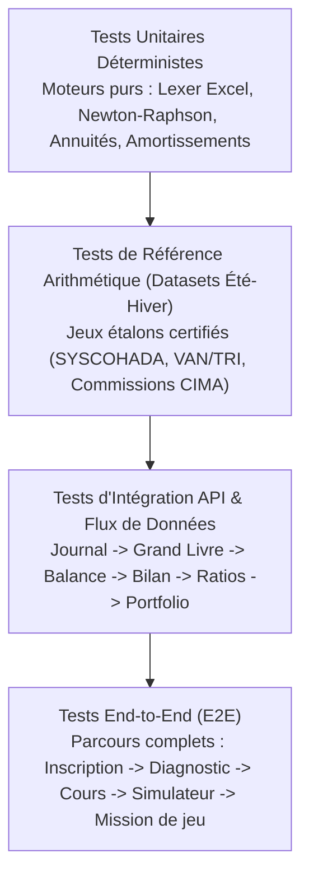

# 07 — Stratégie de Tests et Assurance Qualité Déterministe

**Version :** 1.0.0 — Date : 17 Octobre 2026  
**Équipe responsable :** Équipe I (Assurance Qualité, Validation Mathématique et Sécurité)

---

## 1. Philosophie & Principes Non Négociables d'Assurance Qualité

Dans une application d'ingénierie financière et de formation professionnelle, la moindre approximation numérique est fatale pour la crédibilité de l'apprentissage. La stratégie de test de **FINLEARN IMMERSION** obéit aux principes suivants :
1. **Vérité Déterministe :** Chaque formule financière, comptable ou actuarielle est validée face à des jeux d'essais étalons calculés indépendamment et certifiés par des experts-comptables et analystes financiers.
2. **Tolérance Zéro sur les Incohérences Métier :**
   - Une écriture comptable non équilibrée ne doit JAMAIS pouvoir être validée.
   - Une division par zéro (ex: ratio de rotation avec stock moyen nul) doit générer un état protégé documenté et non un crash de l'interface ou une valeur `NaN` / `Infinity`.
   - Les calculs d'arrondis monétaires sur le FCFA/XOF doivent respecter la règle d'arrondi bancaire à l'unité la plus proche (pas de fractions de centimes dans les états finaux).
3. **Exécution Réelle & Transparence :** Aucun résultat de test n'est simulé ou inventé. Les tests sont exécutés par un outillage automatisé et les rapports de conformité sont enregistrés dans le registre de livraison.

---

## 2. Pyramide des Tests

---

## 3. Matrice des Suites de Tests Unitaires et de Référence

### 3.1 Suite Comptable SYSCOHADA (`tests/accounting/`)
- **`equation.test.ts` :**
  - Validation de l'équilibre fondamental $\text{Actif} = \text{Passif} + \text{Capitaux Propres}$.
  - Détection de 10 cas de déséquilibres provoqués avec diagnostic explicatif exact.
- **`journal.test.ts` :**
  - Blocage strict de la soumission d'écritures dont $\sum \text{Débit} \neq \sum \text{Crédit}$.
  - Validation de la nomenclature des comptes du plan comptable général SYSCOHADA (classes 1 à 8).
- **`financial_statements.test.ts` :**
  - Vérification de la liaison absolue entre le résultat net calculé dans le compte de résultat et le résultat net inscrit au bilan.
  - Test de conformité sur 3 exercices comptables successifs d'une PME d'Abidjan.

### 3.2 Suite Analyse Financière & Ratios (`tests/analysis/`)
- **`ratios.test.ts` :**
  - Calcul et tolérance sur la batterie des 12 ratios normatifs :
    - Liquidité générale : $\text{Actif Circulant} / \text{Passif Circulant}$.
    - Liquidité réduite : $(\text{Créances} + \text{Trésorerie}) / \text{Passif Circulant}$.
    - Autonomie financière : $\text{Capitaux Propres} / \text{Dettes Financières Totales}$.
    - Rentabilité économique (ROA) et rentabilité financière (ROE).
  - Cas limites testés :
    - Passif circulant égal à zéro (gestion d'exception sécurisée).
    - Capitaux propres négatifs (alerte sur fonds propres inférieurs à la moitié du capital).

### 3.3 Suite Laboratoire Excel (`tests/excel/`)
- **`lexer_parser.test.ts` :**
  - Analyse de chaînes de formules valides et invalides.
  - Détection des parenthèses non fermées, opérateurs consécutifs (`=A1++B2`), noms de fonctions inconnus.
- **`evaluator_functions.test.ts` :**
  - Test unitaire unitaire des fonctions : `SOMME`, `MOYENNE`, `MIN`, `MAX`, `SI`, `ET`, `OU`, `SIERREUR`, `SOMME.SI.ENS`, `RECHERCHEX`.
  - Évaluation des références absolues : recopie virtuelle de `$B$1` sur une plage et vérification de la fixité du pointeur.
- **`workbook_audit.test.ts` :**
  - Détection automatique de constantes numériques hardcodées au sein des formules (ex: `=A1*1.18` au lieu de pointer vers la cellule de taux de TVA).

### 3.4 Suite Finance d'Entreprise (`tests/corporate_finance/`)
- **`time_value_loans.test.ts` :**
  - Échéancier d'emprunt à annuités constantes : contrôle que le capital restant dû après la dernière échéance est rigoureusement égal à 0.
  - Calcul d'intérêts et d'amortissement du capital sur un emprunt de 100 000 000 FCFA à 7.5% sur 5 ans.
- **`npv_irr.test.ts` :**
  - VAN calculée à 3 taux différents (5%, 10%, 15%) sur une série de cash-flows irréguliers.
  - TRI calculé par Newton-Raphson : comparaison avec la valeur de référence calculée par solveur certifié (précision à $10^{-5}$).
  - Cas de cash-flows sans changement de signe (absence de TRI réel signalée sans boucle infinie).

### 3.5 Suite Courtage en Assurance CIMA (`tests/insurance/`)
- **`commissions_calculation.test.ts` :**
  - Calcul des commissions par branche :
    - Santé : 10% sur prime nette.
    - Flotte Automobile : 12.5% sur prime nette.
    - Risques Industriels / Dommages : 15% sur prime nette.
  - Rapprochement de bordereaux : détection de 5 écarts volontairement injectés (sous-paiement de 150 000 FCFA sur une police, déduction injustifiée de frais de gestion).
- **`cima_compliance.test.ts` :**
  - Contrôle du délai de paiement des primes selon l'Article 13 du Code CIMA (délai de grâce et suspension de garantie).

---

## 4. Gestion des Cas Limites et Tests de Résilience

| Cas Limite | Risque Métier | Comportement Attendu du Système |
| :--- | :--- | :--- |
| **Dénominateur nul ($0$)** | Crash de l'application ou affichage `Infinity` | Rendu sécurisé d'un état non calculable avec message pédagogique explicite (ex: *"Le stock moyen étant nul, le délai de rotation ne peut être déterminé"*). |
| **Montants négatifs anormaux** | Calculs d'échéances ou de taux d'amortissement absurdes | Blocage au niveau du validateur Zod avec message : *"La durée d'emprunt et le montant du capital doivent être strictement positifs"*. |
| **Nombres décimaux flottants (ex: $0.1 + 0.2$)** | Écart de 0.00000000000000004 FCFA brisant l'égalité débit=crédit | Utilisation systématique de la troncature/arrondi bancaire ou d'entiers en centimes pour toutes les opérations monétaires. |
| **Formule Excel circulaire ($A1 = A1 + 1$)** | Boucle récursive infinie figeant le navigateur | Détecteur de cycle dans le graphe de dépendances de l'évaluateur, avec émission de l'erreur `#CIRCULAIRE!`. |
| **Données manquantes dans un bordereau** | Estimation silencieuse faussant le rapprochement | Signalement explicite de chaque ligne incomplète avec demande de complément, interdiction d'imputer une valeur par défaut arbitraire. |

---

## 5. Critères d'Acceptation et Portes de Validation (Quality Gates)

Une version ou un lot ne peut être considéré comme "Prêt pour livraison" que si :
1. **Taux de succès des tests unitaires et de calcul :** $100\%$ des tests automatisés passent avec succès (`exit code 0`).
2. **Couverture de code des moteurs critiques :** $> 90\%$ de couverture sur les modules `core/accounting`, `core/excel`, `core/finance` et `core/insurance`.
3. **Absence de failles de sécurité critiques :** Audit des dépendances `npm audit` sans vulnérabilité de sévérité élevée ou critique non corrigée.
4. **Vérification d'accessibilité :** Zéro violation bloquante de contraste ou de navigation clavier.
5. **Enregistrement de la preuve :** Tous les résultats observés lors des runs de tests sont consignés dans le registre de livraison `docs/10-registre-des-livraisons.md`.
