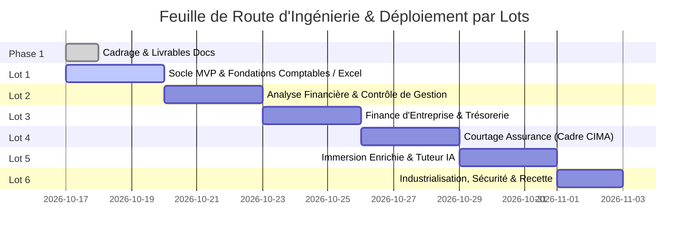

# 09 — Feuille de Route Stratégique et Planification des Lots (Roadmap)

**Version :** 1.0.0 — Date : 17 Octobre 2026  
**Équipe responsable :** Équipe A (Pilotage et Produit) & Direction Technique

---

## 1. Vue d'Ensemble de la Roadmap d'Exécution

La feuille de route est cadencée en **6 lots verticaux cumulatifs**. Chaque lot délivre un ensemble cohérent de fonctionnalités complètes de bout en bout (Interface, Données, Moteurs de calcul, Persistance, Exercices, Simulateurs, Jeux et Tests).

---

## 2. Définition Détaillée des Lots et Jalons Clés

### Lot 1 — Socle Opérationnel & Fondations Pédagogiques (MVP Immédiat)
- **Objectif :** Poser les fondations complètes de l'application, rendre l'ensemble des parcours navigables avec persistance locale et livrer les premiers moteurs de calcul déterministes fonctionnels.
- **Livrables Clés :**
  - Architecture applicative complète (Vite + React + TypeScript + Tailwind CSS).
  - Design system opérationnel avec palette chromatique, typographie, composants atomiques et HUD de jeu.
  - Système d'authentification et gestion des profils avec données de démonstration.
  - Moteur de diagnostic initial adaptatif et calcul du plan d'apprentissage.
  - Moteur comptable SYSCOHADA (Journal, Grand Livre, Balance, Équilibre Débit/Crédit).
  - Laboratoire Excel Fondamental (Grille interactive, formules arithmétiques et logiques, gestion des erreurs).
  - 4 premiers simulateurs calculatoires : Équilibre de l'entreprise, Journal interactif, Rapprochement bancaire, Débogueur Excel.
  - 2 premières missions de jeu interactives 2D complètes : "La Première Journée du Comptable" et "Répare le Tableau de Bord".
  - Suite de tests unitaires et de référence (`tests/`).

### Lot 2 — Analyse Financière, Contrôle de Gestion & Excel Avancé
- **Objectif :** Déployer les outils de pilotage opérationnel pour PME et contrôleurs de gestion.
- **Livrables Clés :**
  - Moteur d'analyse financière : ratios de liquidité/solvabilité/rentabilité, analyse horizontale/verticale.
  - Calcul du BFR, cycle d'exploitation et jours de rotation (DSO, DPO, DIO).
  - Moteur de contrôle de gestion : seuil de rentabilité (break-even point), marge sur coût variable, budget flexible.
  - Laboratoire Excel Avancé : support de `RECHERCHEX`, `SOMME.SI.ENS`, tableaux croisés dynamiques (TCD).
  - Simulateurs associés : Radar des variations, Tableau de ratios, Break-even interactif, Détecteur d'écarts.
  - Missions gamifiées G8 à G21 (Comité de crédit, Le mois rouge, Le bureau débordé).

### Lot 3 — Finance d'Entreprise, Investissement & Trésorerie Approfondie
- **Objectif :** Permettre la modélisation des choix d'investissement et la sécurisation du cash-flow.
- **Livrables Clés :**
  - Moteur mathématique financier : actualisation, valeur temps de l'argent, échéanciers d'emprunts bancaires.
  - Critères d'investissement déterministes : VAN, TRI (Newton-Raphson), délai de récupération.
  - Simulateur de trésorerie opérationnelle à 6 mois et calendrier d'encaissements/décaissements.
  - Missions gamifiées G22 à G27 (Comité d'investissement, Trésorerie sous pression).

### Lot 4 — Finance Appliquée au Courtage en Assurance (CIMA & International)
- **Objectif :** Intégrer la spécialisation sectorielle approfondie du courtage d'assurance.
- **Livrables Clés :**
  - Modèle économique du courtier d'assurance : primes nettes, commissions, taxes d'assurance (CI 14.5%), fonds de tiers.
  - Moteur de gestion de portefeuille : branches Santé, Auto, IARD, calcul du taux de rétention et d'attrition.
  - Rapprochement automatisé des bordereaux de primes et commissions assureurs avec détection d'écarts.
  - Contrôle de conformité CIMA Article 13 (encaissement des primes).
  - Simulateurs de commissions et missions gamifiées G28 à G33.

### Lot 5 — Immersion Enrichie, Assistant IA Pédagogique & Reporting Groupe
- **Objectif :** Enrichir l'expérience apprenant avec tuteur IA explicatif et gestion multi-entités.
- **Livrables Clés :**
  - Tuteur IA conversationnel avec garde-fous stricts (interdiction d'altérer les calculs ou d'inventer des règles).
  - Scènes 2D/3D légères pour la visualisation des flux complexes (client -> courtier -> assureur).
  - Moteur de consolidation pédagogique multi-devises (XOF, EUR, USD) et reporting groupe.
  - Missions d'investigation et d'escape game financier avancées.

### Lot 6 — Industrialisation, Durcissement de Sécurité & Clôture de Recette
- **Objectif :** Préparer le déploiement en production, auditer la sécurité et valider la recette finale.
- **Livrables Clés :**
  - Audit de conformité WCAG 2.2 AA (accessibilité clavier et contrastes).
  - Tests de charge et de performance (chargement perçu < 2 secondes).
  - Audit de sécurité applicative (OWASP Top 10, Zod validation, CSP headers).
  - Documentation technique et guides d'exploitation complets.
  - Rapport de recette finale et PV de conformité exhaustif.
